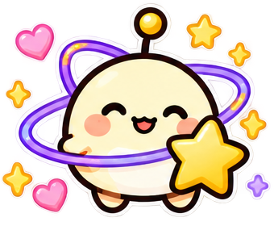
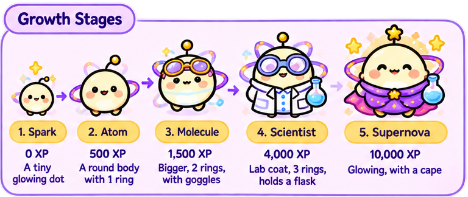
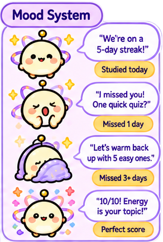
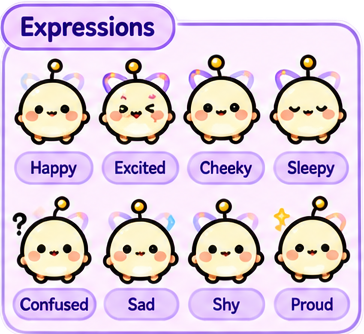
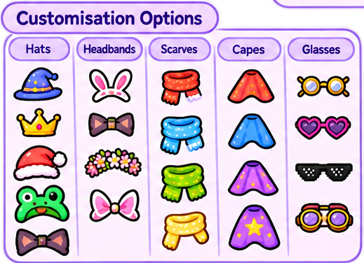
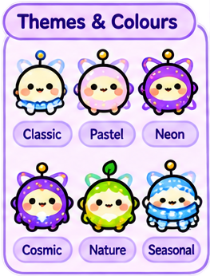
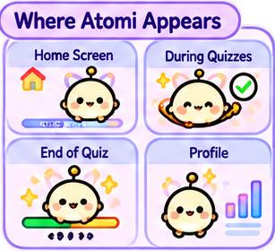

# Mascot

Atomi is a small, round atom creature with a cream body, rosy cheeks, a yellow-tipped antenna and purple orbit rings. Atomi shows progress (XP and stage), reflects study mood (streak) and keeps students motivated.

## Anatomy

| Part | Colour token | Notes |
| --- | --- | --- |
| Body | `cream` | Round, slightly wider at the bottom, thin dark outline |
| Cheeks | `blush` | Two soft ovals under the eyes |
| Antenna | `ink` stalk, `star` ball | Always on top, slightly bouncy |
| Orbit rings | `brand-bright` / `lavender` | 0 to 3 rings, by growth stage |
| Eyes and mouth | `ink` | Dot eyes with a white highlight |

## Growth stages (shows progress)

| Stage | XP | Look |
| --- | --- | --- |
| 1. Spark | 0 | A tiny glowing dot with an antenna |
| 2. Atom | 500 | Round body with 1 ring |
| 3. Molecule | 1,500 | Bigger, 2 rings, wears goggles |
| 4. Scientist | 4,000 | Lab coat, 3 rings, holds a flask |
| 5. Supernova | 10,000 | Glowing, purple star cape, star on the antenna |

Atomi never shrinks or loses a stage.

## Mood system (shows usage)

| Student activity | Mood | Atomi says |
| --- | --- | --- |
| Studied today | Happy, sparkles | "We're on a 5-day streak!" |
| Missed 1 day | Sleepy, yawning | "I missed you! One quick quiz?" |
| Missed 3+ days | Curled up under a blanket | "Let's warm back up with 5 easy ones." |
| Perfect score | Celebrating, confetti | "10/10! Energy is your topic!" |

Moods are never guilt-tripping: a sleepy Atomi invites, it doesn't scold.

## Expressions

Happy, Excited, Cheeky, Sleepy, Confused, Sad, Shy and Proud. Use Happy as the default. Sad is only for a gentle "not quite" moment, never for a broken streak.

## Customisation

Students unlock accessories with badges: hats, headbands, scarves, capes and glasses. Accessories sit on top of the stage outfit and must not hide the eyes or the antenna.

Colour themes: Classic, Pastel, Neon, Cosmic, Nature and Seasonal. Classic is the default and the only theme used in marketing.

## Where Atomi appears

- **Home screen:** large, with a speech bubble, the XP bar and streak.
- **During quizzes and lessons:** small, reacting to each answer.
- **End of quiz:** celebrating, with XP filling up.
- **Profile:** the stage gallery and badges.

## Rules

- Keep shapes simple and cute; animate only small reactions (a bounce, a blink), and turn motion off when the device asks for reduced motion.
- Atomi always faces the student and never covers questions or answers.
- Don't stretch, rotate or recolour the mascot outside the official themes.
- Don't give Atomi a mouth that looks angry, or put Atomi in a scene that mocks a student.
