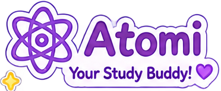

# Atomi

**Study more, grow brighter.** Atomi is a science learning app for Singapore IP students in Year 3 and Year 4. Students learn physics, chemistry, biology and practical science through short lessons and quizzes, with Atomi as their study buddy. Atomi is a small, round atom creature who grows with their XP and reacts to their study streak.

## Brand personality

Atomi is a friendly older study buddy, not a teacher and not a cartoon. The brand is:

- **Encouraging.** Celebrate effort and progress, never shame. Missing days makes Atomi sleepy, never angry.
- **Clear.** Science is explained in short, plain sentences, with real units and real numbers.
- **Playful, in small doses.** Cuteness lives in the mascot, stickers and sparkles. The learning content itself stays calm and readable.

## Voice and writing

| Do | Don't |
| --- | --- |
| "Nice work! That's a 5-day streak." | "AMAZING!!! You're a GENIUS!!!" |
| "So close! Read the explanation." | "Wrong." |
| "I missed you! One quick quiz?" | "You broke your streak." |
| "Learn next: Kinematics" | "Click here to begin your learning journey" |

- Short sentences, second person ("you"). Atomi speaks in the first person ("I missed you!").
- One exclamation mark at most, and only for real wins.
- Name things the way students do: "quiz", "lesson", "streak", "XP".
- Science words are always spelled and capitalised correctly, with SI units (m/s, N, J).
- Emoji: never in UI labels. The mascot and stickers carry the feeling instead.

## Logo

The logo is the atom mark (a nucleus with three orbits) beside the **Atomi** wordmark, with the "Your Study Buddy!" ribbon underneath. Use the supplied artwork (Logos group); never redraw or recolour it.

- Clear space: at least the height of the "A" on every side.
- Minimum width: 120 px on screen.
- The supplied logo is drawn for light backgrounds. On the dark Cosmic surfaces, place it inside a white or `cream` sticker shape (rounded, with the `glow` shadow), or use the text wordmark: "Atomi" in Lexend 700, coloured `brand`.
- The app name in text is **Atomi Science Quiz**; the mascot and brand are **Atomi**.

## Colour

The brand look is **Pastel cosmic**: a soft, dreamy night sky where Atomi glows. Every colour is a pastel version of space: dusky lavender instead of black, butter-yellow stars, candy-coloured planets. Colours are tokens with two themes. **Cosmic** (dark) is the default everywhere; **Daylight** (light) is for printing and for students who switch it on.

Three hero colours:

- **Dusky lavender** (`surface`, `surface-raised`, `surface-panel`): the backgrounds, a soft purple night sky. Layers get slightly lighter as they come forward.
- **Butter star** (`star`): the primary button, XP, stars and rewards. Text on it is always `on-star`. One star-yellow button per screen.
- **Pastel purple** (`brand`): the wordmark, links, orbit rings, the XP bar fill and focus rings.

Atomi keeps their **cream** body (`cream`) and **blush** cheeks in both themes, so the mascot shines against the dark sky.

Supporting colours (`lavender`, `pink`, `sky`, `mint`, `coral`) are for illustrations, planets, stickers and confetti. They are not text colours.

**Subjects** each own a colour so students always know where they are: Physics = `physics` (baby blue), Chemistry = `chemistry` (peach), Biology = `biology` (pistachio), Practical = `practical` (butter yellow). Use the strong token for text and borders and the `-soft` token for fills behind that text.

**States**: `good` for correct answers and "Learned", `bad` for wrong answers. Always pair the colour with a word or tick, never colour alone.

All text tokens meet 4.5:1 contrast on `surface`, `surface-raised` and `surface-panel` in both themes.

## Typography

- **Lexend** (`display`) for headings, scores, XP numbers and the Atomi name. Clean, wide and easy to read, with a science-lab feel.
- **Nunito** (`body`) for everything students read: lessons, questions, buttons and labels. Its rounded ends keep things friendly.
- Both are free Google Fonts: `https://fonts.googleapis.com/css2?family=Lexend:wght@500;600;700&family=Nunito:wght@400;600;700;800&display=swap`
- Lesson text is at least `body-lg` (18 px), with lines under about 65 characters. Light text on dark needs room, so keep line height generous.
- Numbers that line up (scores, XP, leaderboards) use tabular figures.

## Shape and space

- Corners are soft: `radius-md` for buttons and inputs, `radius-lg` for cards, `radius-pill` for chips and progress bars.
- Spacing follows a 4 px base: `space-1` to `space-7`.
- Depth comes from lighter layers, not heavy shadows. The `glow` shadow, a soft lavender halo, is reserved for the mascot, stickers and the one card you want noticed.

## Iconography and illustration

- Sparkles, four-point stars, orbit rings and small planets are the brand's decorative set, drawn in `star`, `brand`, `sky` and `pink`. A few scattered star dots can sit on large dark areas like a night sky.
- Use at most three decorations around the mascot, and none inside lesson text.
- UI icons are simple, rounded and single colour, with 2 px strokes.

## Mascot

See the **Mascot** section for growth stages, moods, expressions, accessories and where Atomi appears.

## Components

Button, Subject card, Status chip, XP bar, Speech bubble and Quiz option are shown in Components, each with its rules. They use the tokens above and the classes in `components/bundle.css` (prefix `at-`). Primary buttons are star yellow; purple buttons (`at-btn-brand`) are for secondary emphasis.
